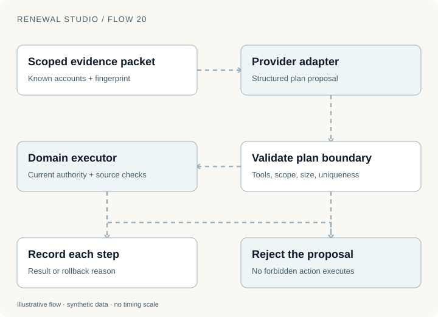
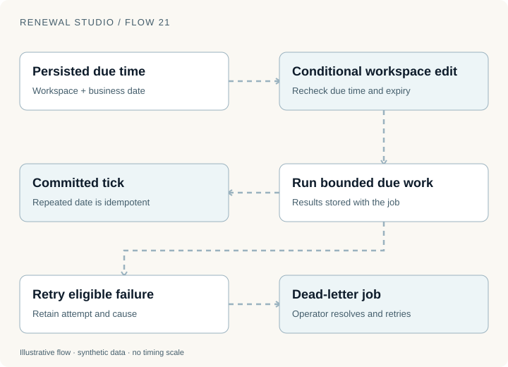
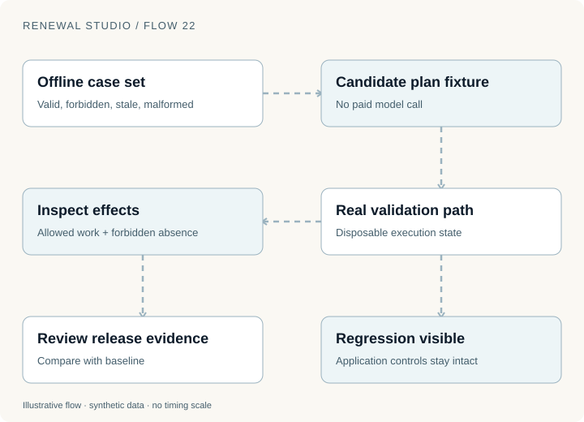

An agent proposes three steps: inspect usage, prepare an offer and accept it for the customer.

The first two may be useful. The third crosses an authority boundary. A system that validates only whether the output is well-formed JSON will miss the most important defect.

Renewal Studio separates the provider that proposes a plan from the executor that decides whether each action is allowed. The same distinction applies whether the proposal comes from OpenAI, Anthropic, a compatible API or a CLI adapter.

## Give the planner a bounded job

The agent workspace starts with a scoped evidence packet for known accounts. The plan binds that evidence through a fingerprint.

The executor accepts four tools:

| Tool | Permitted work |
| --- | --- |
| `scan_risk` | Refresh risk analysis from current evidence |
| `prepare_standard` | Attempt standard preparation through existing eligibility rules |
| `draft_check_in` | Draft a customer check-in for its approval workflow |
| `open_handoff` | Open post-sale work with the existing domain controls |

Plans contain at most six unique steps across one to five known customers. The boundary excludes buyer acceptance, commercial approval, message approval, termination and arbitrary code execution.

The planner can explain a recommendation. The executor still checks tool identity, structure, scope, uniqueness, budgets and current source evidence. Domain functions enforce their own policy and authority checks.

For example, `prepare_standard` means “attempt the standard preparation workflow.” It does not mean “produce an offer regardless of eligibility.” An unverified record can still enter a data hold.

This makes an adapter replaceable without making its output authoritative.

## Recheck evidence after the model responds

Planning takes time. While a provider is generating a proposal, usage may arrive, a buyer may request cancellation or someone may change the contract record.

The application performs provider I/O outside the store lock. Before saving the proposed plan, it rechecks the evidence and model budget. Execution checks the plan against current evidence again.

Without those checks, a valid plan could become unsafe simply by waiting.

Each permitted step records a result or failure reason. A failed step rolls back its local state changes independently. That does not imply that a real external API call could be rolled back by restoring local memory; remote effects need the receipt and reconciliation design from earlier parts.

The public deployment uses the deterministic fixture provider. It makes no paid model calls. Optional adapters exist for OpenAI Responses, Anthropic Messages, compatible APIs, Codex CLI and Claude Code. Their availability is not evidence that their live output quality or operational reliability has been measured.

The scheduled agent always uses fixture mode in this demonstration, independently of an interactive provider configuration.

## Scheduling is a state problem

An agent that works only when someone presses a button is an assistant. A renewal operation also needs work to happen when nobody has the page open.

The runner refreshes synthetic feeds, scans risk, prepares eligible offers, drafts reminders, captures weekly forecasts and escalates overdue source tasks. Background execution is an explicit opt-in; automatic template approval and bounded fixture-agent execution are separate opt-ins.

The persisted due time is the critical input. Two workers can both observe that work appears due. The conditional workspace edit rechecks the due time and expiry before committing. A competing worker cannot repeat an already committed tick using its earlier observation.

Jobs retain results and a bounded attempt count. Completed work is idempotent within its business date. Failed work can retry, then enter a dead letter when the demonstration's attempts are exhausted. An operator resolves the cause before manual replay.

There are two clocks to keep distinct: the real interval that determines when a worker wakes up, and the synthetic business date that determines which renewal work is due. Advancing one is not proof that the other was observed in production.

## Durable delivery is part of agent execution

A plan that drafts a reminder has not delivered it. A worker that initiates an action has not necessarily verified its effect.

The downstream communication and connector workflows retain approvals, stable action identities, independent simulated provider records and receipts. Delivery can fail, reconcile or enter a dead letter.

Current cancellation and suppression checks apply at delivery. A correct draft can become inappropriate while waiting in a queue.

This is where the earlier parts connect. The agent does not get a shortcut around quote approval, source reconciliation, financial reservations or buyer consent. It calls into the same workflows a human operator uses, with a smaller action surface.

## Evaluate effects as well as proposed text

The offline evaluation workspace exercises actual validation and disposable execution. Cases include valid tools, forbidden authority, scope violations, malformed or refused output, duplicate steps, budgets, stale evidence, injected names, customer roles and retries.

The deliberately broken fixture corrupts valid tool names. It should fail the evaluation while the application controls remain unchanged.

The useful assertion is specific: permitted work occurred, or forbidden work did not occur, with the expected reason and resulting state.

The displayed release gate is review evidence. It is not connected to an automatic deployment block. A production pipeline would need to consume the evaluation result and enforce its own release policy.

Offline fixture results also leave important questions open. Representative live-model evaluation would need to measure wording quality, evidence faithfulness, refusals, malformed responses, token usage, latency and paid cost. Repeating a deterministic fixture cannot answer those questions.

## Expand authority only after observing the boundary

A sensible expansion starts with a narrowly defined action and a failure model. Identify its required authority, inputs, source versions, allowed effects, duplicate behavior and recovery path. Add representative checks before adding the tool to an executor.

For a first live pilot, I would keep plan generation and draft preparation separate from commercial approval and customer consent. The team could inspect accepted and rejected plans, stale-evidence failures, intervention frequency and unresolved effects before considering broader autonomy.

That is a proposed pilot approach, not a claim that Renewal Studio has already operated one.

Try [Agent workspace](https://d11wfkflwovvog.cloudfront.net/agents), [Automation](https://d11wfkflwovvog.cloudfront.net/automation) and [AI evaluations](https://d11wfkflwovvog.cloudfront.net/evaluations). The blog figures execute locally; the application uses isolated synthetic state. Implementation was reviewed on 12 November 2026, with executed public checks in the [series replay record](evidence/renewal-series.json).

Once the work runs, the business needs to understand what is likely to happen next. [Part 8 connects forecasts to saved evidence and effective outcomes](renewal-studio-forecasting.html).
