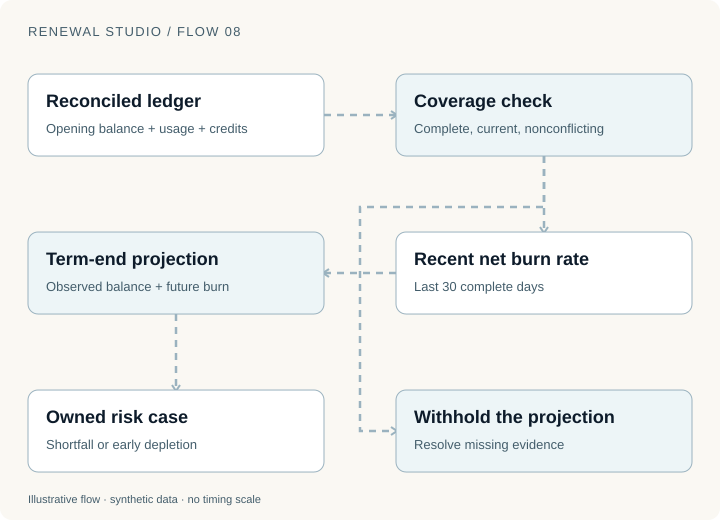
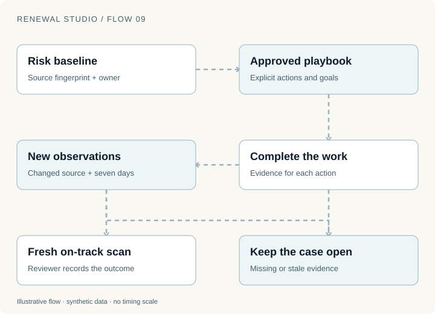
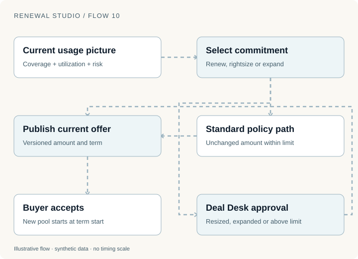

A customer committed $120,000 for the year. With 180 days remaining, the ledger shows $45,000 consumed and a recent burn rate of $250 per day.

At that rate, projected consumption is $90,000. The apparent shortfall is $30,000.

The multiplication is easy. The engineering question is whether the $45,000 is reconciled, whether the recent days are complete, and who should act on the result. A precise projection can still rest on bad evidence.

This part connects consumption monitoring to recovery work and a reviewed commitment offer. It builds on the approval boundaries in [Part 2](renewal-studio-exceptions.html).

## Start with a ledger that can explain its balance

Renewal Studio reconstructs consumed value from a verified opening balance, usage events and credits. Usage is append-only. A repeated event with identical content deduplicates; conflicting content under the same event ID is rejected. An expected source version protects against applying a change to a superseded record.

That gives the system a concrete question to answer: which observations support this balance?

A day with an explicit zero is evidence. A day with no observation is a gap. Treating both as zero would lower the apparent burn rate and might create a false shortfall.



The demo uses the last 30 complete days for the recent net burn rate. It projects from the coverage boundary of the observations, rather than pretending that unobserved days were measured. Amounts use integer cents and rational intermediate calculations, with half-up rounding at the final cent.

For the opening example, assume that the evidence really supports the stated balance, rate and remaining window:

```text
Projected consumption = 45,000 + (250 × 180) = 90,000 USD
Projected utilization = 90,000 / 120,000 = 75%
Projected unused commitment = 120,000 − 90,000 = 30,000 USD
```

This is an illustrative calculation. It is not a forecast of a real customer's demand.

## Make “unknown” a useful state

The fixture flags projected utilization below 95% as shortfall risk. It also detects projected depletion more than 14 days before term end. Those thresholds are configured demonstration policies.

The data-quality checks come first. Stale telemetry, incomplete coverage, duplicate or conflicting observations, an unverified balance and an invalid recent net rate can withhold the projection.

| Observation | Appropriate system response |
| --- | --- |
| Complete evidence, low projected utilization | Open an owned shortfall case |
| Complete evidence, early depletion | Open a capacity investigation |
| Explicit zero-consumption day | Include the zero in the observed window |
| Missing or stale observations | Withhold the estimate and request reconciliation |
| Credit or corrected source version | Reconcile, refresh the evidence and rescan |

An “unknown” case should identify what is missing and who can supply it. Otherwise, withholding a number merely moves the ambiguity into a queue.

The same boundary matters for generated explanations. A model may summarize reconciled evidence. It must not turn an unavailable projection into a confident narrative about the customer's plans.

## A risk case should survive the intervention

A useful risk case preserves its original baseline, source fingerprint, owner and chosen playbook. If the plan changes, prior work should remain understandable instead of disappearing from history.

Imagine that the customer reports an integration blocker. The owner chooses an adoption recovery plan, assigns the integration work and records the intended customer outcome. Completing those actions establishes that the team did the work. It does not establish that consumption recovered.



In the demo, closing a commitment recovery case requires an active plan, all required actions, a new data version, at least seven days, a fresh on-track scan and a review note. Changes to the evidence or business date require a current scan.

That design makes the outcome review harder to fake accidentally. An old scan cannot close a case after its underlying data changes. A completed checklist cannot replace the observation window.

The synthetic scenario can increase usage after a plan starts. That is useful for exercising closure and history. It does not prove that the intervention caused the increase. The simulator chose both the intervention context and the later observations.

In a real pilot, the team would need to separate work performed, observed behavior and causal claims. The case history gives them material to inspect; it does not answer the causal question automatically.

## The next commitment is a commercial decision

A low projection does not determine the correct next commitment. The customer may be consolidating workloads, delayed on an integration or planning a launch outside the observed window. An early-depletion signal may reflect sustained growth or a temporary batch.

Renewal Studio offers three synthetic choices: keep the current commitment, rightsize to 80%, or expand to 125%. An unchanged eligible amount within the configured standard limit can take the standard path. Resizing, expansion and larger amounts require Deal Desk review.



Using the fictional $120,000 agreement, those choices are $120,000, $96,000 and $150,000. The 75% utilization projection is evidence for the recommendation; it is not authority to choose any of them for the buyer.

The quote binds the proposed amount, contract, policy, buyer, billing identity, evidence and relevant dates. If those inputs change before acceptance, the system needs a current proposal and any required approvals.

This protects both sides of the decision. The seller cannot unknowingly publish a recommendation based on old consumption. The buyer cannot accidentally accept a different commitment through a stale page.

## Activation starts a new accounting period

After acceptance, the renewal waits for its effective date. Activation archives the prior consumption ledger and starts the new commitment pool with zero consumed.

The demo does not silently carry unused value into the next term. Carryforward would be a commercial rule requiring explicit implementation and agreement, not a consequence of having an unused balance.

Billing and access still need verified target states. The expansion fixture can fail its first access update after billing succeeds. Reconciliation preserves the completed billing write and retries the missing access step.

That connects the entire chain: trusted observations support a recommendation; review authorizes the proposal; consent creates the agreement; activation starts the new pool; provider verification establishes completion.

## Try a gap before trying a recovery

Open [Consumption risk](https://d11wfkflwovvog.cloudfront.net/consumption) and inspect the coverage evidence before the projection. Explore a data-quality hold, then a shortfall case with an active recovery plan. Use [Commitment deals](https://d11wfkflwovvog.cloudfront.net/deals) to compare unchanged and resized proposals.

The figures run locally in the blog. Application data, usage changes and provider effects are synthetic. Implementation was reviewed on 12 November 2026; the [series replay record](evidence/renewal-series.json) separates executed public checks from these explanatory scenarios. No observed demonstration establishes retention lift or intervention effectiveness.

Some customers have no commitment to renew. [Part 4 follows PAYG value, cancellation and a customer's return](renewal-studio-retention.html).
