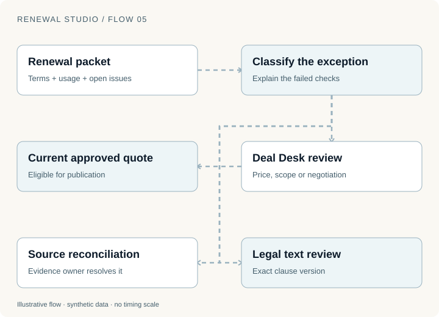
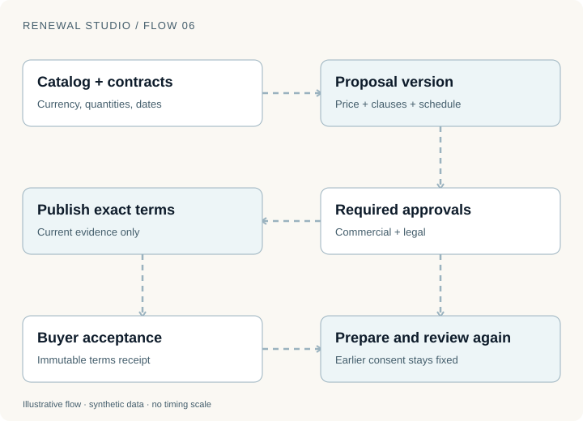
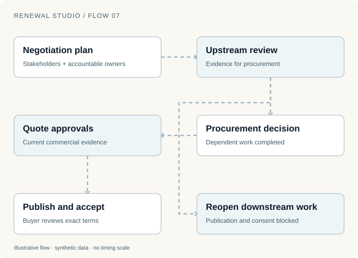

A renewal is ready to go. The customer asks for a shorter term, quarterly invoices and a replacement clause. The system can produce a polished answer in seconds. None of those changes is authorized by the old offer.

That is where a renewal system earns its keep. [Part 1](renewal-studio-standard-renewal.html) followed the standard path. This installment follows the work that leaves it: commercial exceptions, custom agreements, legal review and strategic procurement.

The useful output is a specific decision waiting for the right owner, with enough evidence to make that decision.

## An exception needs more than a queue

Consider three fictional accounts. One wants a discount. One has a billing identity that disagrees with its contract record. One wants a clause changed. Calling all three “human review” hides the actual work.

The discount needs commercial judgment. The identity conflict needs source reconciliation. The clause needs legal authority. Each case should carry the failed checks, proposed terms, source versions, accountable owner and next action. An explanation of the failure is more useful than an unexplained risk score.

In Renewal Studio, an unverified standard contract enters a data hold. An open negotiation leaves the standard path for commercial review. The custom-contract workspace supports reviewed proposals, while legal review records a decision about the proposal's actual text.

Those distinctions prevent a subtle failure: using approval as a substitute for evidence. A person saying “looks fine” cannot make the wrong billing identity correct. The record must be reconciled before a new proposal can depend on it.

An agent can assemble the packet and recommend a next action. It does not acquire the authority of every specialist whose work it summarizes.

## A quote is a versioned object

Custom contracts widen the set of supported decisions. They also widen the evidence that has to remain connected.

The synthetic catalog has independent USD, EUR, GBP and CAD prices. Quantities and volume tiers determine unit pricing; a reviewed proposal discount is then applied. Supported renewal terms include 1, 3, 6, 12, 18, 24 and 36 calendar months. Billing can be upfront, monthly, quarterly or annual, with configured payment terms.

These are implemented demo choices, not universal commercial conventions. The important design is that the service calculates from a controlled catalog and preserves the complete proposal.

| Field in the proposal | Why a reviewer needs it |
| --- | --- |
| Source agreements and versions | Identifies what is being renewed or replaced |
| Products, quantities and currency | Prevents an ambiguous change in scope |
| Term, effective dates and billing frequency | Separates service duration from payment timing |
| Price, discount, service credits and fictional tax | Explains the amount the buyer will see |
| Legal text and review state | Connects approval to the clause actually offered |
| Procurement dependencies | Shows decisions that still block publication |

For a simple worked example, assume a fictional annual service price of $12,000, an 18-month renewal and no tax or credit. The service charge is $18,000. Quarterly billing creates six $3,000 installments. Annual value, service charge and the next invoice are three different amounts, even in this easy case.

An amendment is harder. The application uses ACT/365 with inclusive service days for amendment and coterm adjustments, rounding each charge and source credit to cents. It preserves the charge and unused-service credit separately. That makes it possible to explain the invoice instead of presenting one unexplained net number.

## Approval expires when its subject changes

Suppose Deal Desk approves proposal version 3. Legal then replaces a clause. The application changes the quote version and invalidates the earlier commercial approval.

This can feel repetitive until the alternative becomes concrete: version 3 was reviewed, version 4 was published, and nobody approved the combination of commercial terms and legal text that the buyer accepted.

Every custom proposal needs Deal Desk approval in the demo. Required legal review covers the current text. Publication and acceptance check that the relevant approvals and evidence are still current.

The buyer then accepts a specific proposal. The application records an immutable terms receipt with a digest. This is in-product consent evidence; the demo does not connect to an external signature service or establish real-world signer authority.

A later catalog edit cannot rewrite that receipt. Before acceptance, changed evidence can require rebuilding the quote. After acceptance, a new commercial change needs its own agreement. The system needs to know which side of that boundary it is on.

## Strategic accounts have dependency graphs

A large renewal may have procurement steps that must happen in order. Completing a final checklist item does not help if an earlier review reopens.

The strategic workspace records stakeholders, negotiation plans, owners, blockers and an executive brief. Its procurement dependencies affect whether a quote can be published or accepted. Reopening an upstream dependency reopens downstream work.

For example, a security review may have supported procurement approval for a particular deployment scope. If that scope changes, procurement's earlier completion is no longer sufficient. The interface should expose the reopened dependency and who owns it.

An executive conversation still matters. It can clarify priorities, resolve a blocker or change the proposed arrangement. The resulting decision should enter the same controlled workflow. Otherwise, the most consequential accounts become the least inspectable part of the operation.

## What to hand back to automation

Human review should return a usable decision: approved current terms, a rejected proposal with a reason, or a request for specific missing evidence.

Once a current proposal has the necessary approvals, the system can publish it and collect buyer consent. At the effective date, billing and access still need independent verification. A difficult negotiation does not eliminate the recovery requirements from Part 1.

The handoff back to automation should therefore include the proposal version, effective date, required target states and remaining blockers. “The deal is done” is too vague to drive provisioning.

This also creates a practical way to improve the system. Examine which exception reasons recur, how often packets arrive incomplete, how many proposals need rework and which decisions are waiting for an owner. Those observations can guide better data validation or policy design. They do not, by themselves, justify removing review.

## Try the decision, then change its evidence

Open [Custom contracts](https://d11wfkflwovvog.cloudfront.net/commercial), prepare a proposal and inspect its financial breakdown. Use [Catalog & legal](https://d11wfkflwovvog.cloudfront.net/governance) to change a clause. Observe that the earlier approval cannot authorize the changed quote. Then explore the dependency controls in [Strategic accounts](https://d11wfkflwovvog.cloudfront.net/strategic).

The blog figures are local teaching examples. The linked application performs state transitions in an isolated synthetic workspace. Its prices, tax codes, legal text and authority are fictional; the article describes implementation reviewed on 12 November 2026. The [series replay record](evidence/renewal-series.json) identifies the public checks actually executed.

The next question is what terms to propose when consumption changes. [Part 3 follows the ledger, the risk case and the next commitment](renewal-studio-consumption.html).
