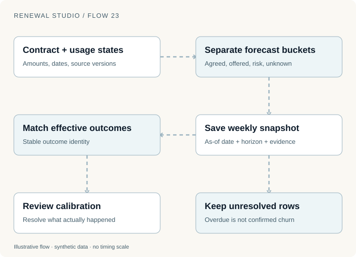
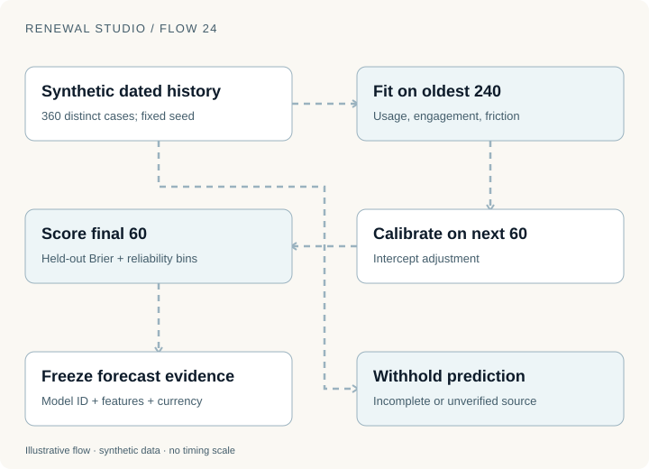
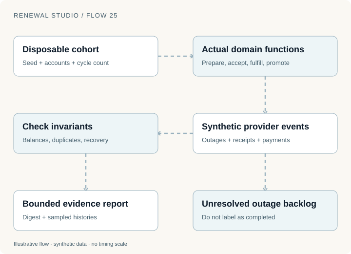

Last week's forecast looked strong. This week's dashboard looks weaker. Did customer behavior change, did a contract move out of the horizon, or did someone finally correct the source record?

A current dashboard alone cannot answer. It shows what the system knows now, not what the business believed then.

Renewal Studio preserves weekly forecasts and connects them to later effective outcomes. It also provides a synthetic prediction model and multi-cycle portfolio experiments. Those are three different tools, with different evidence.

## Keep the operational forecast inspectable

The basic forecast starts with contract dates, agreement amounts, current offers, risk states and trusted usage evidence. It distinguishes agreed and offered work, risk and uncertainty.

Its scenario totals are not probability-weighted model predictions. Consumption utilization and PAYG weekly spend remain different measures from annual agreement value.



The weekly snapshot records its business date, horizon and source rows. Repeating a capture for the same week and horizon preserves the snapshot rather than rewriting the past.

That makes a review concrete. The team can ask which rows moved, which source facts changed and which outcomes have become effective since the earlier forecast.

An overdue row without a confirmed outcome stays unresolved. It does not become churn just to complete a chart. Similarly, an unverified contract should remain visible as uncertainty or an exclusion instead of quietly disappearing from the denominator.

For a fictional review, suppose a $24,000 renewal was offered in the saved snapshot. The buyer later accepts, but the next term has not begun. The offer, agreement and effective outcome are distinct events. A report must state which one it counts.

## A model forecast needs a different evidence trail

The prediction workspace generates 360 distinct synthetic cases with a fixed seed. The oldest 240 fit a regularized logistic model. The next 60 fit a calibration intercept. The final 60 remain held out for scoring.

The dates precede the workspace date. Features describe usage, engagement and friction. The generator is deliberately learnable.



The Brier score measures the mean squared difference between a probability and the observed binary outcome:

```text
Brier score = mean((predicted probability − observed outcome)²)
```

For three fictional predictions of 0.9, 0.6 and 0.2 with outcomes 1, 0 and 0, the score is `(0.01 + 0.36 + 0.04) / 3`, or about 0.137. That calculation describes those three observations, not general model quality.

The application also displays reliability bins with counts. A bin supported by very few examples should not look as convincing as one supported by many.

Held-out synthetic performance checks that the training and scoring machinery behaves coherently on its generated problem. It does not establish accuracy for real customers, where selection, product changes, missing data and behavior can differ.

## Missing evidence should reach the model boundary

Commitment predictions use reconciled utilization and explicit synthetic assumptions. Standard accounts use illustrative activity history; custom accounts use illustrative constants. These are disclosed feature constructions.

Unverified contracts and incomplete required usage withhold predictions. Accepted or declined decisions use their observed states. Currency totals remain separate.

A saved sensitivity forecast preserves the model ID, feature values and amounts. Adjusting usage in that scenario asks how the fixed model responds to the changed input.

It does not establish that causing the same usage change would cause a renewal. Prediction sensitivity and intervention effectiveness require different evidence.

That distinction matters when an agent recommends work. “The score rises when this feature rises” is not sufficient justification for a customer intervention.

## Measure retention from a fixed opening cohort

The performance workspace uses a fixed opening account cohort and effective annual agreement values, separately by currency. PAYG spend and service-allocation schedules are excluded from these retention measures.

Consider two fictional opening agreements: $100 and $100. One later expands to $120; the other contracts to $80.

Net revenue retention is `(120 + 80) / 200 = 100%`. Gross revenue retention caps each retained account at its opening value, so it is `(100 + 80) / 200 = 90%`.

| Measure | What it helps explain |
| --- | --- |
| NRR | Expansion, contraction and churn within the opening cohort |
| GRR | Retained opening value without expansion covering a loss |
| Forecast calibration | Saved expectations compared with matched effective outcomes |
| Recorded human minutes | Observed work entries, not estimated savings |
| Instrumented automation share | Covered commands and worker/agent steps, not every historic action |

Before live workspace outcomes exist, the screen can show a clearly labeled independent historical sample. Mixing that sample into the live cohort would manufacture apparent performance.

## Use portfolio experiments to expose unfinished work

The portfolio simulator creates disposable fictional standard USD customers and runs the application's actual preparation, acceptance, fulfillment, cycle promotion, connector, invoice and payment functions.

Inputs include a seed, account count, cycle count, usage drift, outage percentage, outage duration and whether recovery succeeds. The interface supports up to 5,000 accounts and five annual cycles.



Customer decisions and providers are simulated. Declined customers leave later cohorts. Unresolved outages remain backlog. Duplicate calls exercise idempotency. The prediction model comes from separate fictional history and remains frozen while behavior changes across cycles.

The report checks balances, duplicate writes and recovery alongside predicted and observed decisions. Identical inputs and business dates produce the same evidence digest; elapsed time is excluded. The application retains bounded reports and sampled account histories while preserving the interactive accounts and clock.

This is sequential local domain execution. It is not a concurrent HTTP load test, an AWS capacity benchmark or evidence that 5,000 real customers could renew safely at once.

Leaving outages unresolved is particularly instructive. The successful portion of a portfolio should not hide actions that remain in dead letters. A useful report preserves both.

## Ask what changed, then ask what the evidence supports

Open [Weekly forecasts](https://d11wfkflwovvog.cloudfront.net/forecasts) and compare a saved snapshot with current work. Explore [Predictive models](https://d11wfkflwovvog.cloudfront.net/predictions) for the separate fit, calibration and scoring stages. Use [Performance](https://d11wfkflwovvog.cloudfront.net/performance) and [Portfolio simulations](https://d11wfkflwovvog.cloudfront.net/simulations) to distinguish effective outcomes from simulated experiments.

Implementation was reviewed on 12 November 2026. Figures are local teaching examples; application histories and outcomes are synthetic. The [series replay record](evidence/renewal-series.json) states which public checks were executed. None establishes real prediction accuracy, staffing savings or retention lift.

The final installment connects the workflows to [the AWS architecture and the evidence a real operational pilot would need](renewal-studio-operations.html).
