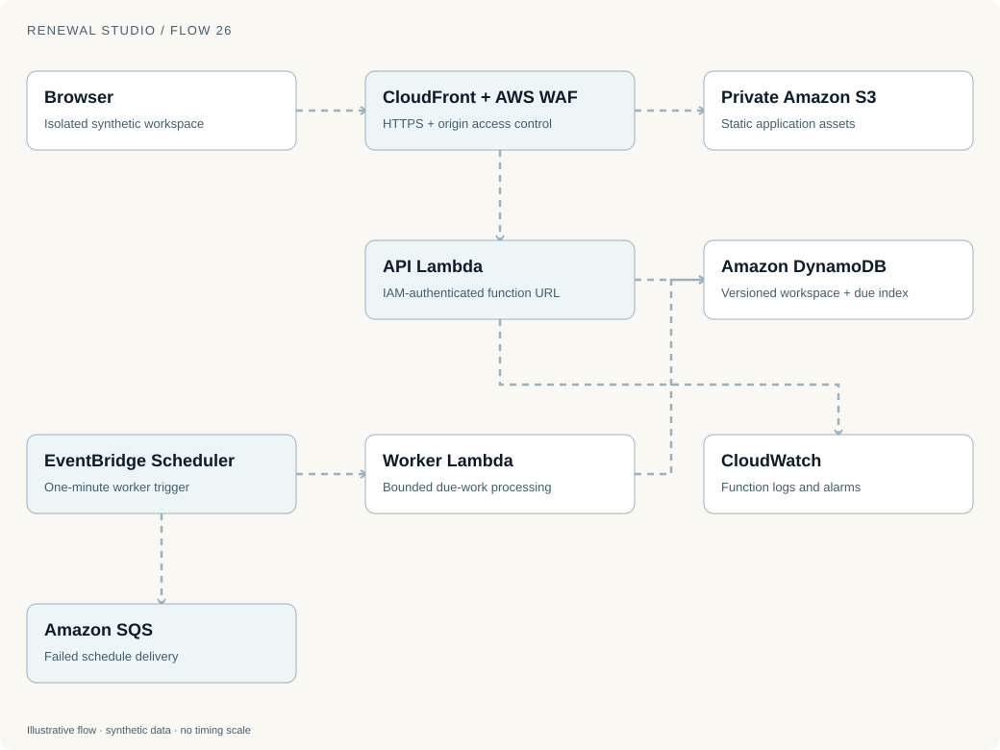
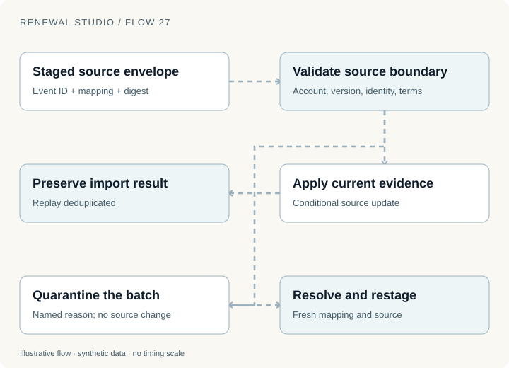
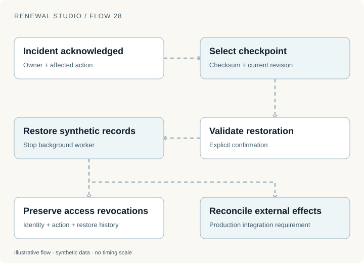

The standard renewal can complete. Exceptions have owners. Consumption cases, cancellations, post-sale work, financial controls, agents and forecasts all have a place to run.

The final question is operational: what happens when these workflows meet real identities, real source systems and providers whose effects live outside the application's database?

Renewal Studio is a working synthetic demonstration hosted on AWS. Its workflows make that question inspectable. They do not make the remaining integration work disappear.

## The hosted application has two execution paths

The browser reaches CloudFront with AWS WAF attached. Static assets come from a private S3 origin. Uncached API requests reach a Lambda function URL protected with AWS IAM authentication and CloudFront origin access control.

The API persists an isolated workspace in DynamoDB. A separate worker Lambda receives a one-minute EventBridge Scheduler trigger and queries an index of due workspaces.

The diagram is an original reconstruction of the application's infrastructure definition reviewed on 12 November 2026. It shows the main configured runtime paths. It is not a fresh audit of every deployed resource. Static SVG, PNG and editable draw.io downloads are available beneath it.

The two execution paths serve different needs. An interactive request should finish bounded work and return. A background worker must find due work, recheck its persisted schedule and retain the result without requiring an open browser.

The worker processes a bounded number of workspaces per invocation. Conditional writes preserve workspace versions and prevent a competing worker from repeating a committed tick.

A separate SQS dead-letter queue receives failed scheduler delivery after configured retries. Application job failures remain in workspace records. Those are different failure layers and need different recovery decisions.

## Protecting the origin is only one boundary

CloudFront origin access control signs requests to the Lambda origin. AWS documents the [Lambda function URL origin pattern](https://docs.aws.amazon.com/AmazonCloudFront/latest/DeveloperGuide/private-content-restricting-access-to-lambda.html) and the corresponding [function URL authentication requirements](https://docs.aws.amazon.com/lambda/latest/dg/urls-auth.html).

That prevents an unsigned public request from using the protected origin directly. It does not establish that a browser user is the authorized buyer for an account.

The application separately uses workspace cookies, origin and CSRF checks, role checks and account-scoped domain authority. The hosted configuration uses secure cookies. API responses are not cached as shared static assets.

The infrastructure also defines function logs and alarms in CloudWatch, selected CloudFront access logs and protected WAF logs in S3, plus CloudTrail management-write records. These signals help investigate requests and infrastructure changes. They are not substitutes for the business record of who approved which terms.

The API and worker have scoped DynamoDB permissions. They do not receive real billing credentials or paid model access in the public fixture deployment.

## Expiry and restoration need application semantics

Hosted synthetic workspaces expire after seven days. The application checks expiry itself. DynamoDB TTL is storage cleanup, not an exact authorization deadline; AWS documents [handling expired items that are pending deletion](https://docs.aws.amazon.com/amazondynamodb/latest/developerguide/ttl-expired-items.html).

Workspace payloads are bounded and versioned, with compressed archives and an encoded size limit. This makes the demo manageable. It is not an unlimited event store for a global renewal business.

Invited-session mode adds synthetic administrators, internal specialists, customers and partners. Internal staff can be scoped to a workspace or one account; customer and partner roles require an account. Object-level checks prevent a scoped user from reaching another account by supplying its ID.

Invitations are single-use and short-lived. Session recovery is also a one-time capability, and revocation disables the identity's sessions and recovery. These controls demonstrate authority transitions. Possession of a synthetic invitation does not verify a real person's employment or buying authority.

A production identity integration would need to map verified identities to those same domain permissions and test offboarding, role changes, account reassignment and recovery.

## Importing a record is a controlled transition

The connector sandbox stages an envelope with an event ID, mapping, source version and payload digest. Applying it checks the account, billing identity, current source evidence and accepted terms.

Changed mappings, stale evidence, identity conflicts and accepted agreements can quarantine a batch without changing the source record. Replaying an identical event preserves its earlier result.

This is a useful contract for a real connector: incoming data proposes a transition that the application validates. It is not automatically entitled to overwrite every field.

The same sandbox models target delivery with stable action IDs, independent simulated provider records, signed receipts, retries and dead letters. Its targets support subscription, commitment, custom and PAYG workflows.

Those provider records still live inside the synthetic workspace. They do not reproduce network partitions, a provider's retention window for idempotency keys or an external administrator changing the target independently.

A real integration needs tests for those conditions, with authoritative reads and a clear decision when the provider's state conflicts with the requested state.

## A checkpoint cannot undo an external payment

The resilience workspace provides incidents, acknowledgements, a local action chain, checksummed checkpoints and controlled restoration.

Restoration checks the selected checkpoint, requires confirmation against the current revision and stops the background worker. It restores synthetic business records while preserving identities, revocations, the action chain and restore history.

Preserving revocations prevents a database recovery from quietly reviving someone whose access was removed.

The action chain covers a bounded recent mutation history with a predecessor anchor. It can reveal accidental changes. An unrestricted database writer could replace the chain, so it is not independently tamper-proof evidence. External anchoring and durable retention remain production work.

Likewise, restoring the application cannot reverse a payment, an email or an entitlement change at a real provider. Recovery must inspect those external effects and explicitly reconcile or compensate them. A successful database restore is only one part of that process.

## A realistic pilot should prove one complete path

I would begin a real pilot with one clearly defined standard contract type, one authoritative source path, one billing target and one access target. Use a bounded account cohort, named operational owners and an explicit stop condition.

This is a proposed next step, not an already completed deployment.

| Pilot area | Evidence required before widening scope |
| --- | --- |
| Identity and consent | Verified buyer authority, account isolation, revocation and exact-version consent |
| Source reconciliation | Freshness, conflicting updates, replay and amendment handling against authoritative records |
| Commercial policy | Approved thresholds, supported terms and owned exception paths |
| Provider effects | Lost acknowledgements, duplicates, outages and independently changed target state |
| Operations | Alert routing, intervention records, recovery runbooks and a tested stop control |
| Records and finance | Agreed retention, audit integrity, privacy handling and accounting integration |
| Agent behavior | Representative live-model evaluation, costs and prohibited-action checks |
| Business outcomes | A defined cohort, observed manual effort and outcome measurement over real cycles |

A shadow phase could compare recommendations with the existing process. A reviewed execution phase could then perform narrowly authorized actions. Expansion should depend on observed error modes and successful recovery, not the number of workflows demonstrated.

The existing system already provides useful places to attach that evidence: source versions, proposal approvals, consent snapshots, action receipts, owned tasks and saved forecasts.

## Follow one decision all the way through

The series began with a customer accepting a renewal and one provider failing. Across nine parts, the same requirement kept returning: preserve the decision, its authority, the evidence it depended on and the effects that still need verification.

Explore [the full demo catalog](https://d11wfkflwovvog.cloudfront.net/demos), then use [Connectors](https://d11wfkflwovvog.cloudfront.net/connectors), [Access & roles](https://d11wfkflwovvog.cloudfront.net/access) and [Resilience](https://d11wfkflwovvog.cloudfront.net/resilience) to inspect the operational boundaries.

The [public replay record](evidence/renewal-series.json) lists the synthetic checks executed for this publication. Backend revision is not exposed by that API; recorded frontend hashes identify observed assets, not the backend build. The [series index](renewal-studio.html) links all nine installments and their downloadable diagrams.

The next milestone is evidence from a narrowly scoped real integration. Until then, the demonstration offers something concrete to review: an executable model of the decisions a renewal operation must make.
