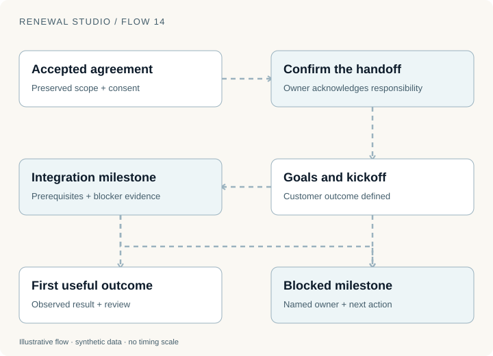
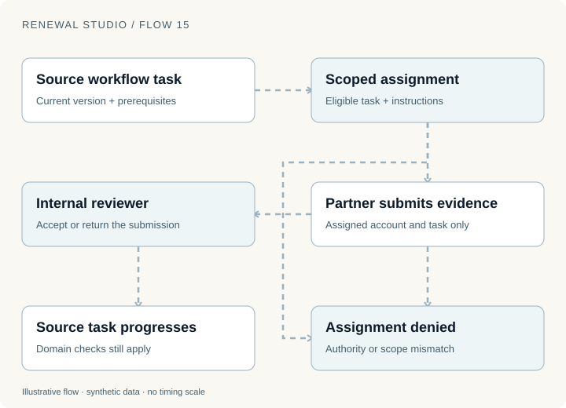
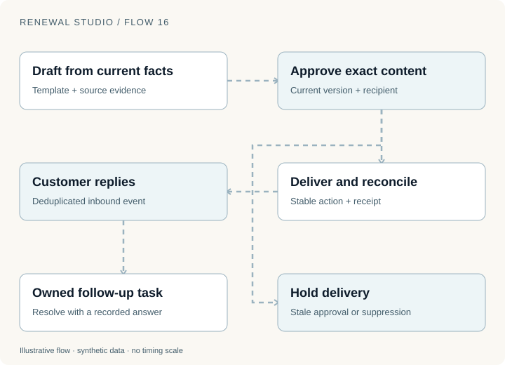

The buyer has accepted. Billing and access are correct. Two weeks later, the customer still has not completed its integration.

The renewal transaction finished, but the customer outcome did not. If the system stops at “closed won,” it loses the work that may determine the next renewal.

Renewal Studio connects an accepted agreement to a post-sale plan, an operational queue and customer communication. The purpose is to make the next unresolved outcome visible, with a person or permitted agent responsible for moving it forward.

## Start with a confirmed handoff

Activation creates a post-sale plan tied to the accepted agreement. The earlier plan can be archived when a new cycle begins. This preserves which commercial context each plan belonged to.

A proposed handoff is not automatically a confirmed handoff. The receiving owner must acknowledge responsibility.

The milestones form a dependency chain: goals and kickoff, integration, then a first useful outcome. Each transition needs its prerequisites and supporting evidence. Open blockers prevent a milestone from completing.

For a fictional API customer, a goal might be to run a defined production-like job successfully. Kickoff clarifies who will build the integration and what success means. Integration evidence demonstrates that the connection works. The outcome checkpoint records whether the useful job actually ran.

Those proposed goals do not create new contract promises. Keeping the accepted scope available alongside the plan helps an owner distinguish an agreed entitlement from an adoption objective.

## A queue should point to the source of truth

The operations queue is derived from source workflows: risk cases, commercial reviews, communication follow-ups, activation recovery and post-sale milestones.

That avoids a common split. A task tracker says “done” while the underlying renewal remains blocked, or a case is resolved while a disconnected queue keeps asking someone to fix it.

Assignment updates the source owner. A stale queue version cannot quietly overwrite a newer assignment. Completing the underlying business work still requires its own evidence and authority.

| Queue item | Evidence that moves the source workflow |
| --- | --- |
| Integration blocker | Observed correction and required milestone prerequisites |
| Consumption reconciliation | A trusted source update and a fresh scan |
| Commercial review | An authorized decision on the current proposal |
| Activation recovery | Matching billing and access state |
| Customer question | A recorded resolution connected to the reply |

The queue also exposes overdue work. Escalation assigns the configured internal backup and records the event. It should not repeatedly bounce the same task among owners with every scheduler tick.

This is why fewer visible tasks is an unreliable success measure. Work can disappear from a queue because it was filtered, reassigned or incorrectly closed. A better review connects task transitions to the source outcome.

## Partners can supply evidence without owning every decision

Some work fits an outsourced partner: usage reconciliation, adoption investigation or integration verification. Other decisions require internal or customer authority, including commercial approval, buyer consent and internal outcome signoff.

The demo's invited-session mode can assign an eligible task to a partner scoped to one account. The partner sees work assigned to that identity, submits the requested evidence and waits for internal review.

The reviewer can assess the submission, but that review does not bypass the source workflow's prerequisites. Integration evidence cannot close a milestone while a required earlier step remains incomplete.

This distinction makes the blended operating model concrete. Software coordinates and checks. A partner supplies bounded work. An internal specialist makes the decision that requires the relevant authority.

Revocation and account scope matter as much as the assignment form. A partner must not gain access to another account by changing an object ID. Revoking the identity must disable its existing sessions and recovery capabilities.

The demonstration authority is synthetic. A real deployment would connect these permissions to an organization's verified identities and operating agreements.

## Communication has a lifecycle, too

An agent drafting an email has completed only the first step of customer communication.

The system needs current source evidence, an approved content version, a recipient, delivery status and a way to handle replies. A failed delivery should remain distinguishable from a delivered message that has not received a response.

Renewal Studio supports drafting, approval, delivery receipts, retries and a synthetic inbox. A customer reply creates an owned follow-up task. Repeated inbound events deduplicate rather than creating several copies of the same question.

Consider a buyer who asks whether a proposed renewal changes an integration limit. The reply should become work for an owner who can answer it from the current terms. The resolution should remain connected to the question.

The message itself cannot accept the contract. That remains an explicit buyer action on the current offer.

Delivery also checks current suppression and cancellation state. Approval from yesterday cannot override a cancellation recorded today. The communication workflow must read the customer's latest decision before it acts.

## Measure work without inventing time savings

The application can record observed human minutes and instrumented automated commands. Those are different measurements.

A recorded 15-minute review is an observation about that review. Three agent steps describe instrumented activity. Neither establishes how many hours would have been spent without the system.

A useful operating review would examine overdue source tasks, incomplete handoffs, reopened milestones, unresolved customer questions and work returned for missing evidence. It would distinguish actions attempted from outcomes verified.

It would also preserve uncertainty. A recorded first outcome may be meaningful evidence of adoption; it is not automatically proof of long-term retention.

The design goal is a small human layer with clear responsibilities. Whether that model improves staffing needs or customer outcomes is a question for measured real operation, not a conclusion supplied by the demo.

## Try completing the task before its prerequisite

Open [Post-sale plans](https://d11wfkflwovvog.cloudfront.net/post-sale) and inspect a milestone's dependencies. Try the [Operations queue](https://d11wfkflwovvog.cloudfront.net/operations) to see which source owns the next decision. In [Conversations](https://d11wfkflwovvog.cloudfront.net/conversations), follow a draft through delivery and a customer question into a task.

The partner workflow is available through [Access & roles](https://d11wfkflwovvog.cloudfront.net/access). Use separate synthetic sessions when exploring different authorities.

The figures are local teaching examples. The application uses fictional identities, messages and customer records; no real email is sent. Implementation was reviewed on 12 November 2026, and the [series replay record](evidence/renewal-series.json) lists the public checks executed.

The next part follows a different kind of unresolved work: [an invoice, a payment and the evidence that money actually moved](renewal-studio-finance.html).
